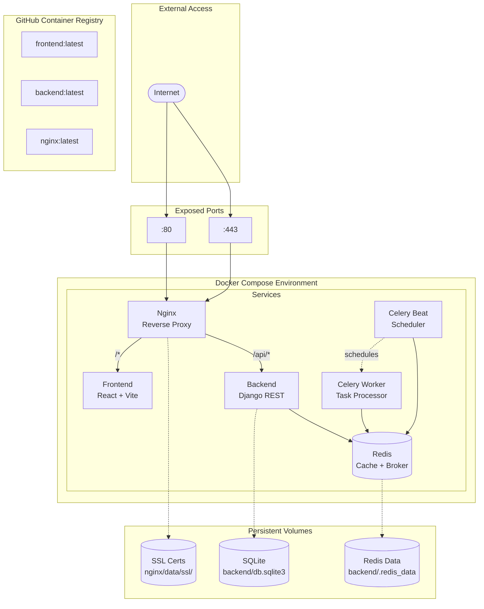
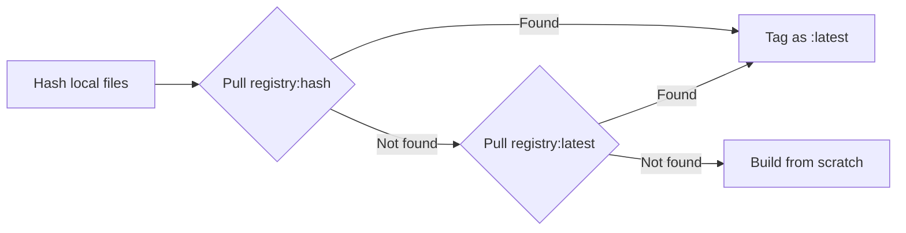

# Docker Architecture

## Overview



## Docker Compose Configurations

The project provides multiple Docker Compose configurations for different environments:

| File | Purpose | Compose project | Use Case |
|------|---------|-----------------|----------|
| `docker-compose.debug.yaml` | Development | `df-dev` | Local development with hot reload |
| `docker-compose.debug.m1.yaml` | Development (macOS ARM) | `df-dev` | `just dev::mac` |
| `docker-compose.test.yaml` | Testing | `df` (slot 0) / `df-sN` | Playwright E2E testing |
| `docker-compose.slot.yaml` | Test override, slot N ≥ 1 | `df-sN` | Suffixed container names, HTTPS on `1N443`, per-slot redis data |
| `docker-compose.slot-offline.yaml` | Test override, slot N ≥ 1 with background off | `df-sN` | Blanks `DISCORD_BOT_TOKEN` / `STEAM_API_KEY` on backend, celery and the bot |
| `docker-compose.run.yaml` | One-off `test::run` without a slot | `df-run-<hex>` | Ephemeral backend run, tmpfs redis, removed afterwards |
| `docker-compose.ci.override.yaml` | CI override | `df` | GitHub Actions only |
| `docker-compose.prod.yaml` | Production | `df` | Production deployment |
| `docker-compose.release.yaml` | Release | `df` | Versioned release deployment |

## Compose Projects and Test Stack Slots

Every compose call goes through one helper (`scripts/slots.py`), which always passes
an explicit `-p <project>` and absolute `-f` paths. Run it through
`just test::compose <args>` (add `--stack dev` for the dev stack) rather than raw
`docker compose`.

- **Test stacks are per worktree.** Each worktree gets a slot N in 0-9 and its own
  project: slot 0 is `df` on ports 80/443 (`https://localhost`, what CI uses);
  slot N ≥ 1 is `df-sN` on HTTPS port `10443 + N*1000` only. `just test::slot` shows
  this worktree's slot; `just test::slots` lists all of them.
- **The dev stack is project `df-dev`** with containers `frontend-dev`, `backend-dev`,
  `redis-dev` and `nginx-dev`. It still publishes 80/443, so it cannot run at the same
  time as test slot 0; the helper refuses before any container starts.
- **Discord bot and celery beat** run on slot 0 and dev only. Slots N ≥ 1 scale them to
  zero unless `just test::background on` is set for that slot.

Details, commands and troubleshooting: [Test Stack Slots](../development/test-stack-slots.md).

## Services

### Frontend Service

```yaml
frontend:
  image: ghcr.io/kettleofketchup/draftforge/frontend:latest
  # Development: mounts ./frontend/ for hot reload
  volumes:
    - ./frontend/:/app
```

- **Dev Image**: `frontend-dev:latest` - Includes dev dependencies
- **Prod Image**: `frontend:latest` - Optimized production build

### Backend Service

```yaml
backend:
  image: ghcr.io/kettleofketchup/draftforge/backend:latest
  depends_on:
    - redis
  volumes:
    - ./backend/:/app/backend
```

- **Dev Image**: `backend-dev:latest` - Debug mode enabled
- **Prod Image**: `backend:latest` - Production optimized

#### Debugging a Hung Backend

If daphne stops answering (requests time out, WebSockets drop, container still
up), dump every thread's Python stack before restarting it. `backend/asgi.py`
registers `faulthandler` on `SIGUSR1`; the dump goes to stderr, so it lands in
the container log, and the process keeps running.

```bash
ssh dota.kettle.sh docker kill -s USR1 df-backend-1
ssh dota.kettle.sh docker logs --tail 500 df-backend-1
```

Each thread prints as `Thread 0x... (most recent call first):` followed by its
frames. Look for the event-loop thread (daphne/twisted/asyncio frames) blocked on
a lock or `join`, and for request threads parked in `async_to_sync`. In a test
stack the container is named after the slot's compose project (`df-sN-backend-1`).

Only the daphne process (`backend.asgi`) installs the handler; Celery keeps its
own `SIGUSR1` traceback dump.

Requests that daphne cancels (client disconnect, then `application_close_timeout`)
log a `request_cancelled` warning with `http.method`, `http.route` and
`duration_ms` instead of `request_completed`.

### Redis Service

```yaml
redis:
  image: redis:8.2.1-alpine
  volumes:
    - ./backend/.redis_data:/data
```

Persistent data storage for cache across restarts.

### Nginx Service

```yaml
nginx:
  image: ghcr.io/kettleofketchup/draftforge/nginx:latest
  ports:
    - "80:80"
    - "443:443"
  volumes:
    - ./nginx/default.template.conf:/etc/nginx/templates/
    - ./nginx/data/ssl/:/etc/letsencrypt/live/dota.kettle.sh/
```

### Celery Worker Service

```yaml
celery-worker:
  image: ghcr.io/kettleofketchup/draftforge/backend:latest
  command: celery -A config worker -l info
  depends_on:
    - redis
    - backend
```

Processes background tasks from the Redis queue. Uses the same image as the backend service.

### Celery Beat Service

```yaml
celery-beat:
  image: ghcr.io/kettleofketchup/draftforge/backend:latest
  command: celery -A config beat -l info
  depends_on:
    - redis
    - celery-worker
```

Scheduler that triggers periodic tasks (e.g., league match sync every 60 seconds).

## Environment Files

| File | Description |
|------|-------------|
| `docker/.env.dev` | Development environment variables |
| `docker/.env.test` | Test environment variables |
| `docker/.env.prod` | Production environment variables |
| `docker/.env.release` | Release version and settings |

### Environment Variables

| Variable | Description | Default |
|----------|-------------|---------|
| `NODE_ENV` | Environment mode (dev/test/prod/release) | - |
| `DOMAIN` | Site domain | `localhost` |
| `FRONTEND_HOST` | Frontend host | `localhost` |
| `FRONTEND_PORT` | Frontend port | `3000` |
| `BACKEND_HOST` | Backend host | `localhost` |
| `BACKEND_PORT` | Backend port | `8000` |
| `SSR_API_URL` | Backend URL for SSR requests | `http://backend:8000/api` |

### SSR_API_URL

The frontend uses Server-Side Rendering (SSR). During SSR, the Node.js server needs to reach the backend API. Since it runs inside Docker, it uses the Docker service name.

```bash
# Default - uses Docker Compose service name
SSR_API_URL=http://backend:8000/api

# Kubernetes example
SSR_API_URL=http://backend-service:8000/api

# External backend
SSR_API_URL=https://api.example.com/api
```

!!! info "Why not /api?"
    On the client (browser), requests to `/api` are proxied by Nginx. But during SSR, the Node.js server makes requests directly - it needs the full internal URL to reach the backend container.

## Image Registry

All images are hosted on GitHub Container Registry:

```
ghcr.io/kettleofketchup/draftforge/
├── frontend:latest
├── frontend-dev:latest
├── backend:latest
├── backend-dev:latest
└── nginx:latest
```

## Content-Hash Tagging

Docker images are tagged with a SHA256 hash of the files that determine their installed dependencies. This detects stale images — if a dependency changes (e.g. a new npm package), the hash changes, and pulls/builds know to update.

### What Gets Hashed

| Service | Files | Script |
|---------|-------|--------|
| **frontend** / **frontend-dev** | `frontend/Dockerfile`, `frontend/package-lock.json` | `scripts/hash-docker-image.sh frontend` |
| **backend** / **backend-dev** | `backend/Dockerfile`, `poetry.lock` | `scripts/hash-docker-image.sh backend` |
| **nginx** | `nginx/Dockerfile`, `nginx/entrypoint.sh`, `nginx/default.template.conf` | `scripts/hash-docker-image.sh nginx` |

Source code is **not** hashed — it's mounted at runtime, not baked into the image.

### How It Works



1. **Hash** — `sha256sum` of dependency files → content hash
2. **Pull** — try `image:hash` first (exact match), fall back to `image:latest`
3. **Build** — tags image with `:hash` and `:latest`
4. **Push** — pushes `:hash` and `:latest` tags

Docker Compose files reference `:latest` — the pull step handles tagging the correct image as `:latest`.

### Dev vs Release Tagging

| Operation | Tags | Use Case |
|-----------|------|----------|
| `just docker::all-build` | `:hash` + `:latest` | Development builds |
| `just docker::all-push` | `:hash` + `:latest` | Push to registry (CI) |
| `just docker::release::push` | `:version` + `:hash` + `:latest` | Production releases |

### Commands

```bash
# Inspect current hashes
just docker::hash              # All services
just docker::hash frontend     # Single service (full hash)

# Build with hash tags
just docker::all-build

# Pull by hash (falls back to latest)
just docker::all-pull

# Push hash + latest tags
just docker::all-push

# Release: includes version tags
just docker::release::push
```

### CI Integration

Two workflows use hash tagging:

- **`build-docker-images.yml`** — Triggers on push to `main` when Dockerfiles or lock files change. Builds and pushes hash-tagged images.
- **`playwright.yml`** — Pulls images by hash before running tests. Falls back to building if no image matches. Test jobs start the image and test-DB pulls (`just ci::prefetch-start`) right after the registry login, while Python, Node and Playwright install, and join them with `just ci::prefetch-wait images|db`. They skip the buildx builder; a fallback rebuild boots one with `just ci::buildx-builder`.

### Build Timing

Every `docker::buildx` build with BuildKit (not podman) ends with a report of its slowest
steps, from `docker buildx history logs` via `scripts/buildx_timing.py`:

```text
── slowest build steps (buildx frontend-dev (runtime-dev): 2m03s) ──
     63.0s  [runtime-dev 3/3] RUN npx playwright install --with-deps chromium
     41.3s  [deps 2/4] RUN npm ci
  … plus 4 cached step(s)
```

In GitHub Actions the total is also a `::notice` annotation and the table goes to the
job summary. `just ci::timing` collects these reports across runs, along with queue
waits, step durations and per-command timings parsed from the job logs (composite
actions such as `setup-playwright-stack` only show their inner steps there):

```bash
just ci::timing                                   # last 12 runs of the main workflows
just ci::timing --runs 30 --workflows playwright.yml
```

It writes CSVs and `summary.md` to `.ci-timing/` (gitignored). It needs only `python3`
and an authenticated `gh`.

## Common Docker Operations

```bash
# Build all images
just docker::all-build

# Push to registry
just docker::all-push

# Pull latest images
just docker::all-pull

# Start development
just dev::debug

# Start production locally (known broken: renders `-p .`)
just dev::local-prod
```

## Networking

### Development Network
Services communicate via Docker's default bridge network.

### Test Network
Creates an isolated `test-network` for E2E testing:

```yaml
networks:
  test-network:
    driver: bridge
```

Compose scopes the network per project (`df_test-network`, `df-s2_test-network`), so
every slot has its own network and its own nginx `localhost` alias. No subnets are
pinned.

## Volume Mounts

### Development Volumes
- Source code mounted for hot reload
- Database files persisted locally
- Redis data is per stack: named volume `<project>_redis_data` for test stacks
  (`df_redis_data` for slot 0, `df-sN_redis_data` for slot N), `backend/.redis_data-dev` (dev).
  The test stack uses a named volume so its redis definition does not depend on the
  worktree path; a bind mount made a run from another worktree recreate the container.

### Production Volumes
- Only database and SSL certificates mounted
- No source code access

## SSL Certificates

Development uses self-signed certificates in `nginx/data/ssl/`.

The release stack (`docker/docker-compose.release.yaml`) reads its certificate from
`nginx/data/certbot/configs/live/dota.kettle.sh/` on the host. The repo no longer
ships any tooling to issue or renew it.
