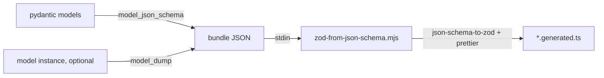

# Pydantic to Zod

When the frontend needs a backend type, define it once as pydantic models and generate
the Zod schemas from them. Field constraints (`min_length`, `pattern`, enums,
`extra="forbid"`) carry over, so the frontend validates with the same rules as the
backend.



| Piece | Path |
|---|---|
| Python half | `backend/common/zod_export.py`: `zod_bundle()` and `write_bundle()` |
| TypeScript half | `frontend/scripts/zod-from-json-schema.mjs` (`--out`, `--check`, `--in`) |
| First user | `backend/notifications/export_schema.py` and `just py::gen-message-types` |

## The models

Two kinds of binding, with different model config:

| | API payloads | Static data (catalogues) |
|---|---|---|
| Example | a view's request/response bodies | `backend/notifications/registry.py` |
| Field names | snake_case, as DRF sends them (no alias generator) | `alias_generator=to_camel` |
| `extra="forbid"` | requests only; never on responses, so a browser on an old build accepts new fields | yes |
| `data=` in the bundle | no | yes, emitted as a typed const |

Both set `json_schema_serialization_defaults_required=True` on models the backend
serializes. Without it a field with a default is optional in the schema and
`field?: T | undefined` in TypeScript.

Use one root model whose `$defs` cover everything the frontend needs. It becomes
`<Title>Schema`, and each nested model or enum becomes `<Name>Schema` plus
`type <Name>`, so pick class names that read well in TypeScript.

The `api` Claude skill (`.claude/skills/api/`) walks through an API binding end to end,
from the axios call to the query hook.

## The exporter

Keep it free of Django imports so it runs under `python -I`:

```python
from common.zod_export import write_bundle, zod_bundle

write_bundle(
    zod_bundle(
        Registry,
        source="backend/thing/registry.py",
        regen="just py::gen-thing",
        data=REGISTRY,          # optional: emit the instance as a typed const
        data_name="THING_REGISTRY",
    )
)
```

## The recipe

```just
gen-thing *args:
    {{quote(python)}} -I {{quote(backend / "thing/export_schema.py")}} \
        | node {{quote(root / "frontend/scripts/zod-from-json-schema.mjs")}} \
            --out {{quote(root / "frontend/app/lib/thing/thing.generated.ts")}} "$@"
```

Commit the generated file and add `just py::gen-thing --check` to the `unit` job in
`.github/workflows/unit-tests.yml`. That job has both the poetry venv and node.

## Limits

The converter refuses what it cannot render faithfully instead of falling back to
`z.any()`:

- recursive models (a `$def` that reaches itself);
- `$ref` outside `#/$defs/`, or a `$ref` with sibling keywords such as `default`
  (a default on a field whose type is another model or an enum produces one);
- a bundle whose root schema has no `title`;
- a `oneOf` without a `discriminator`, or one whose members are not `$ref`s.

Tagged unions (`Annotated[A | B, Field(discriminator="type")]`) become
`z.discriminatedUnion("type", [ASchema, BSchema])`, so `z.infer` keeps the union type.

Model and field validators (`@model_validator`, `@field_validator`) do not reach Zod.
Write a Vitest test for any rule the frontend must also enforce.

`json-schema-to-zod` is pinned exactly in `frontend/package.json`: a new version can
change the generated text, and the `--check` step fails until you regenerate.
