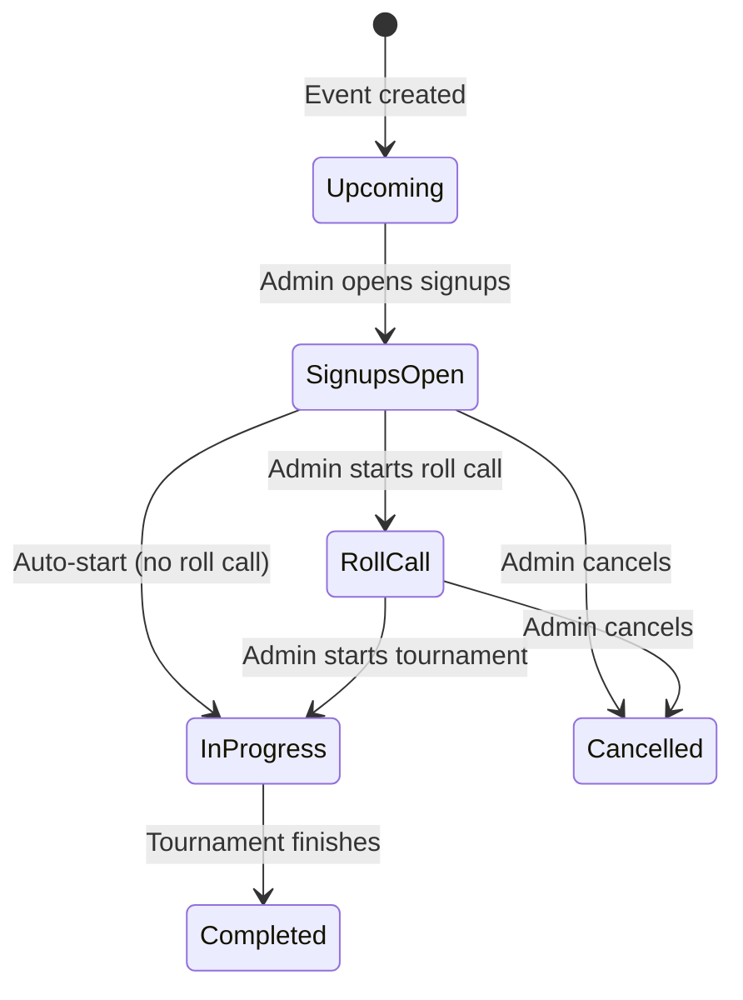

# Roll Call, Ready Check & Signups

Manage player attendance with RSVP confirmations, waitlists, and a dedicated roll call page before tournaments start. Events, series and organization defaults can also store ready check settings ([Mandatory RSVP Confirmation](#mandatory-rsvp-confirmation)).

## Overview

The roll call system ensures the right players are confirmed before a tournament begins. Admins freeze signups, review attendance on a dedicated page, and start the tournament with the confirmed roster.

<figure markdown="span">
  { width="500" }
  <figcaption>20-player roll call: confirming attendance and starting a tournament</figcaption>
</figure>

[:material-play-circle: Watch roll call demo](https://assets.kettle.sh/draftforge/videos/roll_call.webm)

---

## Flow



### 1. Signups Open

Players RSVP from the event page. Each signup shows:

- **Position number** (#1, #2, ...) — first-come-first-served
- **Status badge** — RSVP, Pending Approval, Approved, Confirmed, Waitlisted
- **UserStrip** — avatar, name, positions, the org MMR badge for the event's game (`B:` for Dota 2, `DL:` for Deadlock), and league ticket-match stats (rank, games, win rate, last 5 results) when the event's tournament has a league

Admin actions per signup: Approve, Reject, Confirm.

Approve opens the MMR dialog titled "Set {game} org MMR" for the event's game. The value is required (an empty input no longer approves at 0); Dota allows 0, other games need at least 1. Dota events show the rank signals card and a suggested range. Deadlock events show the player's self-reported rank and its date, and no suggestion. See [Org MMR per game](../org-mmr.md).

### 2. Start Roll Call

Admin clicks "Start Roll Call" on the event page. A confirmation dialog appears:

> "Freeze signups and begin roll call? Players will need to be confirmed before the tournament can start."

After confirming, the browser navigates to `/rollcall/:eventId`. Starting roll call also opens the event's [ready check](#the-ready-check). Starting it again on an event already in roll call returns success and changes nothing.

### 3. Roll Call Page

The dedicated roll call page (`/rollcall/:eventId`) shows:

- **Header** with back button, event name, state badge
- **Summary badges** — "X confirmed / Y needed" and "Z awaiting"
- **Confirmed section** — players who confirmed (with Remove button)
- **Awaiting Confirmation section** — approved players (with Confirm + Reject buttons)
- **Other section** — any remaining signups

The confirm, reject and remove dialogs have a reason field. It is optional unless the event's [Staff reasons](../events.md#staff-reasons) choice requires one for that action. The approval recap has the same field; approving a waitlisted signup counts as a placement, confirming or rejecting does not. Reasons appear in the signup's staff-only History.

Keyboard flow stays quick: select an approved row and press **1**, type the required reason, then **Enter** to confirm. Under Optional, **1**, **Enter** still confirms with no typing. **2** opens Reject or Remove for the selected row. The list's shortcuts pause while a reason dialog is open. Submitting closes the roll call dialog and advances selection immediately; a later request failure shows an error, and a newly required reason opens a reason prompt with the submitted text preserved. On other screens the dialogs wait for success before closing.

Starting roll call, and opening, escalating or closing the ready check, need no staff reason: they run the event's bulk rules rather than deciding on one member. Voice-presence overrides and held-check resolves still require their own reason.

### 4. Start Tournament

When enough players are confirmed (meets `min_players` threshold), the "Start Tournament" button enables. A confirmation dialog shows:

> "Start the tournament with X confirmed players?"

After confirming, the tournament is created with the confirmed roster and the browser navigates back to the event page. Approved players who never confirmed stay out of the tournament.

### Roster during signups

The event's tournament roster follows one rule per phase:

| Phase | Who is on the roster |
|-------|----------------------|
| Signups open, `roll_call_enabled` off | Approved and confirmed players |
| Signups open, `roll_call_enabled` on | Confirmed players only; approved players wait for roll-call confirmation |
| Roll call | Confirmed players only |
| Start tournament straight from signups | Approved and confirmed players, whatever the flag |

The roster is resynced when roll call starts, when signups are reopened from roll call, and when `roll_call_enabled` changes while signups are open. Starting roll call removes approved players who have not confirmed; reopening signups adds them back when the flag is off. Reopening only restores roster entries; it never changes teams.

A player who is a member, captain or deputy of a team in the tournament is never removed by a resync, because removal would also take them off the team. The Start Roll Call and Reopen Signups API responses list those players' user IDs in `roster_kept_on_team`; the event page does not show this list yet. Cancelling, rejecting, demoting or unconfirming one player's signup is an explicit action and still removes them from the roster and their team.

---

## Waitlist

When an event reaches `max_players`, new RSVPs go to the waitlist:

- **Position tracking** — a waitlisted player's position is their rank among the waitlisted players in line order (see [The line is the queue](signup-ledger.md#the-line-is-the-queue))
- **Automatic promotion** — when someone cancels, is rejected or switches to Maybe, the next waitlisted player in line is promoted. A seat freed by staff moving a player to the waitlist stays open for staff to fill
- **Waitlist tab** — always visible on the event page with count, even when empty

---

## RSVP Behavior

| Action | Result |
|--------|--------|
| RSVP (first time) | Creates signup with status based on event config |
| RSVP (already signed up) | Error toast: "User has already signed up" |
| Cancel RSVP | Sets status to cancelled, opens slot for waitlist |
| RSVP after cancel | Signs the same signup up again, keeping its history. `line_withdraw_forfeits` decides whether it goes to the back of the line or gets its old place back |
| Maybe → RSVP | Switches the same signup to Main. `line_switch_restamps` decides whether it goes to the back of the line |
| RSVP → Maybe | Switches the same signup to Maybe and frees its seat for the next waitlisted player. `line_switch_restamps` decides whether it goes to the back of the line |
| RSVP when full | Added to the waitlist; its position is its rank in line order |
| RSVP after being dropped | Error on the web, in Discord and for tentative RSVPs: "You were dropped from this event". The Dropped row is kept |

### Dropped status

`Dropped` is a removed signup status, like Cancelled and Rejected. It belongs to the ready check: a member who does not confirm in time is dropped when an automatic check closes. Automatic mode is not live on this site yet, so nothing sets it in practice. Only staff can reinstate a dropped signup; the member's own reinstate request is refused. Where it does appear:

- dropped signups don't count towards the signup total, the waitlist threshold or the tournament roster;
- the event page and the roll call page list them under removed signups with a **Dropped** badge, and staff get no Remove or Restore action on them;
- the member sees "You were dropped from this event" and cannot cancel, decline or RSVP again;
- Discord signup lists show them with the declined members.

---

## Configuration

These event config fields control signup behavior. **Game** column flags fields that only apply to one game type (Dota 2 vs Deadlock).

| Field | Default | Game | Description |
|-------|---------|------|-------------|
| `auto_approve` | false | any | Auto-approve signups (skip pending state) |
| `auto_confirm` | false | any | Auto-confirm approved signups |
| `max_players` | null | any | Maximum signups before waitlisting |
| `min_players` | null | any | Minimum confirmed players to start tournament |
| `roll_call_enabled` | false | any | Players join the roster only after confirming (see [Roster during signups](#roster-during-signups)) |
| `require_steam_id` | false | any | Require Steam ID (Dota Friend ID / Deadlock Friend ID) for approval |
| `require_profile_complete` | false | any | Require complete profile for approval (per-game definition: Dota needs rank + positions; Deadlock needs `rank` text) |
| `require_mmr_verified` | false | Dota | Require admin-verified MMR for approval |
| `allow_active_mmr` | true | Dota | Allow signups that claim a current MMR rank |
| `allow_previous_rank` | true | Dota | Allow signups that record a previously-held rank (no current screenshot required) |
| `allow_battlecup_rating` | true | Dota | Allow Battle-Cup-only signups (`rank_status="never"` + tier) |
| `min_mmr` | null | Dota | Minimum MMR threshold for auto-approval |
| `discord_require_rank_screenshot` | false | Dota | Discord/web modal require a `.png/.jpg/.jpeg/.webp` rank screenshot for `rank_status="active"` only — "previous" rank captures the medal+star without a screenshot |
| `discord_require_battlecup_screenshot` | false | Dota | Require a Battle Cup screenshot for `rank_status="never"` |
| `line_withdraw_forfeits` | true | any | A member who withdraws, declines or is rejected and signs up again goes to the back of the line; when off, they get their old place back |
| `line_switch_restamps` | true | any | Switching between Main and Maybe moves the signup to the back of the line; when off, it keeps its place |
| `roll_call_mode` | `manual` | any | `manual` (shown as **Staff-verified**: staff confirm members on the roll call page) or `automatic` (members confirm themselves) |

---

## Mandatory RSVP Confirmation

!!! info "Service and API, not yet scheduled or messaged"
    The ready check service and its API exist, and starting roll call now opens a check. Staff-verified roll call behaves as before: nobody is dropped automatically. Automatic mode is still treated as staff-verified on this site: its drop rules (the completion threshold and the low-completion action) are built but switched off until members get a Ready button. Nothing opens, escalates or closes on a schedule yet, and no Discord message or DM is sent; those come with #530 and #531. The start cull is not built yet either.

The **Ready check** tab in the event, series and organization defaults dialogs holds these settings. A new event created from the organization page pre-fills them from the org defaults, except `auto_confirm`.

### The toggle

**Mandatory RSVP Confirmation** turns roll call on. Every rostered member must confirm before teams are made. In **Staff-verified** mode staff check who confirmed and nobody is dropped automatically. **Automatic** mode drops unconfirmed members when the check closes, but it stays switched off on this site until members can confirm themselves (#530, #534); until then staff verify roll call in both modes. Switching the toggle on sets the mode to **Automatic** and turns `auto_confirm` off, unless roll call was already on when the dialog opened, in which case the saved mode is kept. Switching it off only clears `roll_call_enabled`, so the other settings are kept for next time. An existing event with a staff-verified roll call shows the toggle on with the mode left as **Staff-verified**.

Everything under the toggle is collapsed by default:

- **Ready check settings**: mode, who is asked, the timings, the completion threshold and the two member notices.
- **Start cull and voice**: the event voice channel and the cull. This block works whether or not the toggle is on.

### Who gets each message

Planned recipients, once the automatic ready check ships (#530, #543, #533). Nothing below is sent yet, and the tab says so.

| Setting | Message | Recipients | Channel |
|---------|---------|------------|---------|
| Opens | Ready button request | Every member in scope | DM |
| Nudge unconfirmed members | Escalation nudge | Members still unconfirmed | DM |
| Nudge unconfirmed members | Unconfirmed count | Staff | Ops notice |
| Ops notice per unconfirmed member | One chase task per member | Staff | Ops notice |
| If too few confirm: non-binding or hold | Urgent alert | Staff | Ops notice |
| DM members on their first sign-up | Confirmation is mandatory | The member signing up | DM, or a reply only they can see if DMs are closed |
| DM members who are dropped | Drop notice | Each dropped member | DM (members can opt out under roster changes) |
| Start cull | Drop notice | Each removed member | DM |
| After the cull, fill open seats by | Promotion | Each member moved into a seat | DM |

"Staff" for ops notices means the organization's owner, admins and staff, league staff when the event belongs to a league, and the event's host and helpers: they see the notices on the event page and can act on held checks. An organization can also route ops notices to Discord channels, roles or users. The organization's promoters are not told unless they hold one of those roles or a route names them.

### Timings

All timings are minutes before the event's start, except the ops chase, which counts back from the close:

With the defaults, the steps fire in this order (minutes before start):

```text
open ──── chase ──── escalation ──── close ──── start
 120        40           30            10
```

The chase is 30 minutes before the 10-minute close, so it fires at 40, before the escalation. The chase has no fixed place relative to the escalation. The rules are:

- the check closes after it opens (`open > close`);
- escalation falls between open and close (`open > escalation >= close`), or is 0 to turn it off;
- the chase lands after the check opens (`chase + close < open`), or is off. This is its only limit.

These rules apply even with the toggle off, so turning the check on later never exposes a broken timing. A rule is checked only when you create something or change one of its fields, so older events with out-of-order values can still be edited for anything else.

### The completion threshold

If fewer than `ready_check_min_completion_pct` percent of members have confirmed when the check closes, `ready_check_low_completion_action` decides what happens:

| Value | Label | Effect |
|-------|-------|--------|
| `non_binding` | Make the check non-binding (drop nobody) | Nobody is dropped; unconfirmed members are confirmed so they stay on the roster |
| `hold_for_staff` | Hold drops for staff, the host or helpers to decide | Org or league staff, the event host or helpers decide who is dropped |
| `drop_anyway` | Drop unconfirmed anyway | Unconfirmed members are dropped regardless |

### The ready check

A ready check is opened when roll call starts. It asks every member in scope to confirm: approved and confirmed members, plus waitlisted members when the scope is `main_and_fill`. Members approved or added by staff while the check is open are asked too. The settings are copied onto the check when it opens, so later edits to the event do not change a check that is already running.

The check moves through these phases:

| Phase | Meaning |
|-------|---------|
| `open` | Members are being asked |
| `escalated` | Escalated by an operator. No nudge message is sent yet (#530) |
| `held` | Below the threshold with `hold_for_staff`: staff must resolve it, with a reason, before the tournament can start |
| `closed` | Final. Outcome `staff_verified` (nobody dropped), `binding` (unconfirmed members dropped), `non_binding` or `staff_resolved` |
| `cancelled` | Signups were reopened, or the event was cancelled, restarted or completed before the check closed |

Starting the tournament closes an open check first. A staff-verified check closes without dropping anyone, exactly as roll call did before. If the close holds the check, the tournament does not start and the roll call page shows "The ready check is held for staff; resolve it before starting."

A member who tries to confirm after the check has closed is told to contact the host by name (or the event staff when the event has no host). The host, helpers and staff can still confirm that member, for example someone promoted from the waitlist into a seat freed by the close: the ledger row records that the closed check was overridden. Members kept by a non-binding close or excused by a staff resolve are confirmed, so they stay on the roster when the tournament starts. Confirming members, holds, drops and resolutions are all written to the signup ledger.

#### Who can run the ready check

- the organization owner, admins and staff;
- league staff, for events in a league;
- the event **host** and **helpers**.

Promoters can run it only if they also hold one of those roles. The same people see and resolve the event's [ops notices](../../development/ops-notices.md). Host and helpers get no other staff rights from this: reopening signups, starting the tournament, approving or rejecting signups, and the attendance panel stay with event staff. The staff board UI comes with #534; until then the host and helpers use the API below. A member can confirm only themselves.

#### API

| Method and path | Who | Body | Returns |
|-----------------|-----|------|---------|
| GET `/api/events/<id>/ready-check/` | operator | | `{"ready_check": ReadyCheck or null}` |
| POST `/api/events/<id>/ready-check/open/` | operator | | `{"ready_check", "created", "event"}`; 400 when it cannot open |
| POST `/api/events/<id>/ready-check/escalate/` | operator | | `{"ready_check", "changed"}`; 409 `no_ready_check` |
| POST `/api/events/<id>/ready-check/close/` | operator | | `{"ready_check", "changed", "dropped_user_ids", "promoted_signup_ids"}`; 409 `no_ready_check` |
| POST `/api/events/<id>/ready-check/resolve/` | operator | `{"apply_drops": bool, "keep_signup_ids": [int], "reason": str}` | like close; 400 on a missing reason, 409 `not_held` |
| POST `/api/events/<id>/ready-check/confirm/` | operator | `{"user_id": int}` | `{"result", "entry"}`; 409 `ready_check_closed`, `not_in_check` or `no_ready_check` |
| POST `/api/events/<id>/ready/` | the signed-in member | | same as confirm, always for the caller |

"Operator" means anyone listed under [Who can run the ready check](#who-can-run-the-ready-check). The reason on resolve is required, 1 to 500 characters. With `apply_drops`, members named in `keep_signup_ids` are excused and the rest of the unconfirmed members are dropped; without it, everyone unconfirmed is excused. Refusals on confirm carry `{"code", "error", "host"}`.

#### Conduct

When a check closes, [Conduct](../organization-conduct.md) records members who confirmed as attended through the ready check. With a staff-verified check, members who are not confirmed when the event ends stay pending for staff to decide, including members approved after the check closed and members staff unconfirmed after it closed. Once automatic mode is live, a member dropped by a binding close (whether the host, a helper or staff closed it) is recorded as a no-show; staff can still override any outcome from the Attendance panel.

#### Known gaps until line placement ships

- "Maybe" (tentative) RSVPs are never asked.
- There is no out-of-range exclusion: everyone in scope is asked.
- Seats freed by drops are filled from the waitlist in line order, with no line tiers yet.
- A promoted member who has not confirmed when the tournament starts stays on the event but misses the starting teams. Promotion never skips manual approval.

### Start cull and voice

The start cull removes members who are not in the event voice channel a set number of minutes after the start, then fills the open seats from the line or by order of arrival in the call. Voice presence can also count as confirming. The voice channel picker lists the server's voice and stage channels.

Start cull, voice presence confirms and fill by voice arrival all need an event voice channel. The start cull and fill by voice arrival are saved settings only; they do not run yet (#533).

### Voice presence

The bot tracks linked members signed up to the event, in the event's voice or stage channel. It watches signups-open and roll-call events scheduled from 24 hours ago to 6 hours ahead, in-progress events started within the last 24 hours, and events with an open, escalated or held ready check even outside that window. Tracking does not depend on **Voice presence confirms** being on. Unknown Discord accounts and people without a signup get no presence row.

Joins and leaves update presence immediately. A full snapshot every 60 seconds repairs missed updates and refreshes a heartbeat per channel and per guild. Missing channels are left alone, not treated as empty. During a gateway disconnect the bot sends no snapshots or heartbeat. Feed ages are available through the operator API; a missing or unavailable heartbeat has age `null`. Consumers checking freshness must use the event's channel age, not just its guild age.

With **Voice presence confirms** on, a join confirms the member while the check is open or escalated and the event is in roll call. The member must be in the check and eligible to confirm, not dropped or excused. This works in staff-verified mode too. Fresh feed presence (seen within 180 seconds) also confirms members when the check opens, and snapshots reconcile pending members. Leaving never un-confirms anyone. Turning the setting on mid-check takes effect only at the next check; turning it off stops voice confirmations immediately.

#### Operator overrides

Staff, the host and helpers can set presence by hand through `POST /api/events/<id>/voice-presence/`, with `user_id`, `present` and a required reason of 1–500 characters. The member must already have a signup. The ledger records `voice_presence_set` with the operator and reason; a confirmation caused by it links back through `caused_by`.

A manual value stays pinned through snapshots until the member's next real gateway join or leave. It writes no feed timestamps and gives no voice attendance credit for Conduct. A manual present override confirms only when it is set during an accepting check with voice confirmations enabled. A pin set before a check opens does not confirm at open; use staff confirmation instead. Marking someone absent never un-confirms them.

`GET /api/events/<id>/voice-presence/` returns `feed` (`guild_id`, `age_seconds`, `channel_age_seconds`), `voice_channel_id`, and `presences` with each member's `user_id`, `present`, `source` (`feed` or `manual`) and feed timestamps. Both methods require operator access; promoters have no access unless they also hold an operator role. This is API-only until the staff board ships (#534).

#### Bot voice states

The bot explicitly enables the non-privileged `voice_states` intent. It caches watched channels for 60 seconds, reports only relevant gateway transitions, and sends an immediate snapshot after connecting or resuming. One bounded serial queue sends reports and builds snapshots when dequeued, preserving gateway order. Recent gateway transitions take precedence over snapshots for 30 seconds. Reports use the internal token- and IP-protected API; the bot never accesses the database.

### Ready check fields

| Field | Default | Range | Description |
|-------|---------|-------|-------------|
| `roll_call_enabled` | false | | Mandatory RSVP Confirmation on or off. Cannot be on together with `auto_confirm` |
| `roll_call_mode` | `manual` | `manual`, `automatic` | Staff-verified or Automatic |
| `ready_check_scope` | `main_only` | `main_only`, `main_and_fill` | Who is asked: the main roster only, or the main roster and the fill list |
| `ready_check_open_minutes` | 120 | 1–1440 | Minutes before start that the check opens |
| `ready_check_escalation_minutes` | 30 | 0–1440 | Minutes before start to DM unconfirmed members a nudge; 0 turns it off |
| `ready_check_close_minutes` | 10 | 0–1440 | Minutes before start that the check closes |
| `ready_check_chase_minutes` | 30 | 1–1440 or null | Minutes before close to raise one ops notice per unconfirmed member; null turns it off |
| `ready_check_min_completion_pct` | 70 | 0–100 | Completion threshold, in percent |
| `ready_check_low_completion_action` | `non_binding` | see above | What happens below the threshold |
| `ready_check_notify_on_signup` | true | | DM members on their first sign-up that confirmation is mandatory |
| `ready_check_drop_notice` | true | | DM members who are dropped |
| `start_cull_enabled` | false | | Remove members absent from the voice channel after start |
| `start_cull_minutes_after` | 1 | 0–120 | Minutes after start that the cull runs |
| `post_cull_fill_mode` | `line_order` | `none`, `line_order`, `voice_arrival` | How seats freed by the cull are filled: not at all, from the line, or by order of arrival in the event call |
| `event_voice_channel_id` | `""` | Discord channel ID | The event voice channel |
| `voice_presence_confirms` | false | | Count presence in the event voice channel as confirming |

The reference preset uses Automatic mode, asks the main roster and the fill list, and turns the start cull on.

!!! note "Open minutes on existing rows"
    On upgrade, `ready_check_open_minutes` is copied from `discord_confirm_attendance_hours` × 60, capped at 1440, for existing events, series and org defaults. The hours field stays, because the attendance reminder still uses it.
