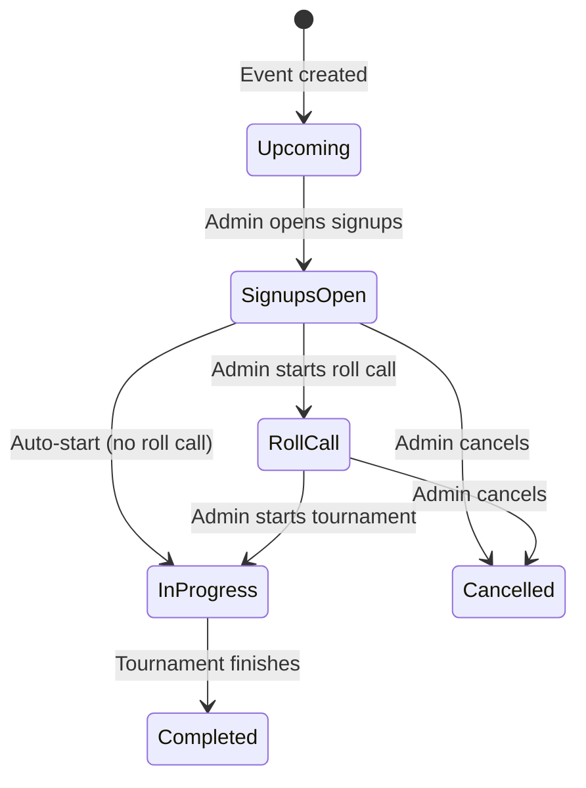

# Roll Call, Ready Check & Signups

Manage player attendance with RSVP confirmations, waitlists, and a dedicated roll call page before tournaments start. Events, series and organization defaults can also store ready check settings ([Mandatory RSVP Confirmation](#mandatory-rsvp-confirmation)).

## Overview

The roll call system ensures the right players are confirmed before a tournament begins. Admins freeze signups, review attendance on a dedicated page, and start the tournament with the confirmed roster.

<figure markdown="span">
  { width="500" }
  <figcaption>20-player roll call: confirming attendance and starting a tournament</figcaption>
</figure>

[:material-play-circle: Watch roll call demo](https://assets.kettle.sh/draftforge/videos/roll_call.webm)

---

## Flow



### 1. Signups Open

Players RSVP from the event page. Each signup shows:

- **Position number** (#1, #2, ...) — first-come-first-served
- **Status badge** — RSVP, Pending Approval, Approved, Confirmed, Waitlisted
- **UserStrip** — avatar, name, positions, MMR badges, and league ticket-match stats (rank, games, win rate, last 5 results) when the event's tournament has a league

Admin actions per signup: Approve, Reject, Confirm.

### 2. Start Roll Call

Admin clicks "Start Roll Call" on the event page. A confirmation dialog appears:

> "Freeze signups and begin roll call? Players will need to be confirmed before the tournament can start."

After confirming, the browser navigates to `/rollcall/:eventId`.

### 3. Roll Call Page

The dedicated roll call page (`/rollcall/:eventId`) shows:

- **Header** with back button, event name, state badge
- **Summary badges** — "X confirmed / Y needed" and "Z awaiting"
- **Confirmed section** — players who confirmed (with Remove button)
- **Awaiting Confirmation section** — approved players (with Confirm + Reject buttons)
- **Other section** — any remaining signups

### 4. Start Tournament

When enough players are confirmed (meets `min_players` threshold), the "Start Tournament" button enables. A confirmation dialog shows:

> "Start the tournament with X confirmed players?"

After confirming, the tournament is created with the confirmed roster and the browser navigates back to the event page. Approved players who never confirmed stay out of the tournament.

---

## Waitlist

When an event reaches `max_players`, new RSVPs go to the waitlist:

- **Position tracking** — each waitlisted player gets a queue position
- **Automatic promotion** — when someone cancels or is rejected, the next waitlisted player is promoted
- **Waitlist tab** — always visible on the event page with count, even when empty

---

## RSVP Behavior

| Action | Result |
|--------|--------|
| RSVP (first time) | Creates signup with status based on event config |
| RSVP (already signed up) | Error toast: "User has already signed up" |
| Cancel RSVP | Sets status to cancelled, opens slot for waitlist |
| RSVP after cancel | Deletes old signup, creates fresh one |
| RSVP when full | Added to waitlist with position number |
| RSVP after being dropped | Error on the web, in Discord and for tentative RSVPs: "You were dropped from this event". The Dropped row is kept |

### Dropped status

`Dropped` is a removed signup status, like Cancelled and Rejected. It belongs to the ready check: a member who does not confirm in time is dropped. In this release nothing sets it yet. Where it does appear:

- dropped signups don't count towards the signup total, the waitlist threshold or the tournament roster;
- the event page and the roll call page list them under removed signups with a **Dropped** badge, and staff get no Remove or Restore action on them;
- the member sees "You were dropped from this event" and cannot cancel, decline or RSVP again;
- Discord signup lists show them with the declined members.

---

## Configuration

These event config fields control signup behavior. **Game** column flags fields that only apply to one game type (Dota 2 vs Deadlock).

| Field | Default | Game | Description |
|-------|---------|------|-------------|
| `auto_approve` | false | any | Auto-approve signups (skip pending state) |
| `auto_confirm` | false | any | Auto-confirm approved signups |
| `max_players` | null | any | Maximum signups before waitlisting |
| `min_players` | null | any | Minimum confirmed players to start tournament |
| `roll_call_enabled` | false | any | Require roll call before tournament start |
| `require_steam_id` | false | any | Require Steam ID (Dota Friend ID / Deadlock Friend ID) for approval |
| `require_profile_complete` | false | any | Require complete profile for approval (per-game definition: Dota needs rank + positions; Deadlock needs `rank` text) |
| `require_mmr_verified` | false | Dota | Require admin-verified MMR for approval |
| `allow_active_mmr` | true | Dota | Allow signups that claim a current MMR rank |
| `allow_previous_rank` | true | Dota | Allow signups that record a previously-held rank (no current screenshot required) |
| `allow_battlecup_rating` | true | Dota | Allow Battle-Cup-only signups (`rank_status="never"` + tier) |
| `min_mmr` | null | Dota | Minimum MMR threshold for auto-approval |
| `discord_require_rank_screenshot` | false | Dota | Discord/web modal require a `.png/.jpg/.jpeg/.webp` rank screenshot for `rank_status="active"` only — "previous" rank captures the medal+star without a screenshot |
| `discord_require_battlecup_screenshot` | false | Dota | Require a Battle Cup screenshot for `rank_status="never"` |
| `roll_call_mode` | `manual` | any | `manual` (shown as **Staff-verified**: staff confirm members on the roll call page) or `automatic` (members confirm themselves) |

---

## Mandatory RSVP Confirmation

!!! info "Settings only, for now"
    This release stores, validates and edits the ready check settings. Nothing reads them yet: the ready check itself, the escalation nudge, the ops chase, drop notices and the start cull arrive in follow-up releases. With every setting at its default, events behave exactly as before.

The **Ready check** tab in the event, series and organization defaults dialogs holds these settings. A new event created from the organization page pre-fills them from the org defaults, except `auto_confirm`.

### The toggle

**Mandatory RSVP Confirmation** turns roll call on. Every rostered member must confirm before teams are made. In **Staff-verified** mode staff check who confirmed and nobody is dropped automatically. **Automatic** mode will drop unconfirmed members once the automatic ready check ships in a later release; until then staff verify roll call in both modes. Switching the toggle on sets the mode to **Automatic** and turns `auto_confirm` off, unless roll call was already on when the dialog opened, in which case the saved mode is kept. Switching it off only clears `roll_call_enabled`, so the other settings are kept for next time. An existing event with a staff-verified roll call shows the toggle on with the mode left as **Staff-verified**.

Everything under the toggle is collapsed by default:

- **Ready check settings**: mode, who is asked, the timings, the completion threshold and the two member notices.
- **Start cull and voice**: the event voice channel and the cull. This block works whether or not the toggle is on.

### Timings

All timings are minutes before the event's start, except the ops chase, which counts back from the close:

With the defaults, the steps fire in this order (minutes before start):

```text
open ──── chase ──── escalation ──── close ──── start
 120        40           30            10
```

The chase is 30 minutes before the 10-minute close, so it fires at 40, before the escalation. The chase has no fixed place relative to the escalation. The rules are:

- the check closes after it opens (`open > close`);
- escalation falls between open and close (`open > escalation >= close`), or is 0 to turn it off;
- the chase lands after the check opens (`chase + close < open`), or is off. This is its only limit.

These rules apply even with the toggle off, so turning the check on later never exposes a broken timing. A rule is checked only when you create something or change one of its fields, so older events with out-of-order values can still be edited for anything else.

### The completion threshold

If fewer than `ready_check_min_completion_pct` percent of members have confirmed when the check closes, `ready_check_low_completion_action` decides what happens:

| Value | Label | Effect |
|-------|-------|--------|
| `non_binding` | Make the check non-binding (drop nobody) | Nobody is dropped |
| `hold_for_staff` | Hold drops for staff | Staff decide who is dropped |
| `drop_anyway` | Drop unconfirmed anyway | Unconfirmed members are dropped regardless |

### Start cull and voice

The start cull removes members who are not in the event voice channel a set number of minutes after the start, then fills the open seats from the line or by order of arrival in the call. Voice presence can also count as confirming. The voice channel picker lists the server's voice and stage channels.

Start cull, voice presence confirms and fill by voice arrival all need an event voice channel.

### Ready check fields

| Field | Default | Range | Description |
|-------|---------|-------|-------------|
| `roll_call_enabled` | false | | Mandatory RSVP Confirmation on or off. Cannot be on together with `auto_confirm` |
| `roll_call_mode` | `manual` | `manual`, `automatic` | Staff-verified or Automatic |
| `ready_check_scope` | `main_only` | `main_only`, `main_and_fill` | Who is asked: the main roster only, or the main roster and the fill list |
| `ready_check_open_minutes` | 120 | 1–1440 | Minutes before start that the check opens |
| `ready_check_escalation_minutes` | 30 | 0–1440 | Minutes before start for the escalation nudge; 0 turns it off |
| `ready_check_close_minutes` | 10 | 0–1440 | Minutes before start that the check closes |
| `ready_check_chase_minutes` | 30 | 1–1440 or null | Minutes before close that ops are told who has not confirmed; null turns it off |
| `ready_check_min_completion_pct` | 70 | 0–100 | Completion threshold, in percent |
| `ready_check_low_completion_action` | `non_binding` | see above | What happens below the threshold |
| `ready_check_notify_on_signup` | true | | Tell members when they sign up that confirmation is mandatory |
| `ready_check_drop_notice` | true | | Tell dropped members they were dropped |
| `start_cull_enabled` | false | | Remove members absent from the voice channel after start |
| `start_cull_minutes_after` | 1 | 0–120 | Minutes after start that the cull runs |
| `post_cull_fill_mode` | `line_order` | `none`, `line_order`, `voice_arrival` | How seats freed by the cull are filled: not at all, from the line, or by order of arrival in the event call |
| `event_voice_channel_id` | `""` | Discord channel ID | The event voice channel |
| `voice_presence_confirms` | false | | Count presence in the event voice channel as confirming |

The reference preset uses Automatic mode, asks the main roster and the fill list, and turns the start cull on.

!!! note "Open minutes on existing rows"
    On upgrade, `ready_check_open_minutes` is copied from `discord_confirm_attendance_hours` × 60, capped at 1440, for existing events, series and org defaults. The hours field stays, because the attendance reminder still uses it.
