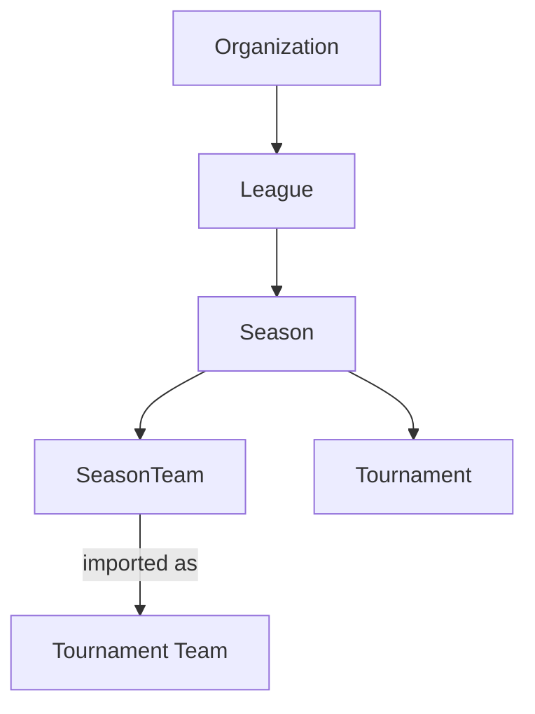
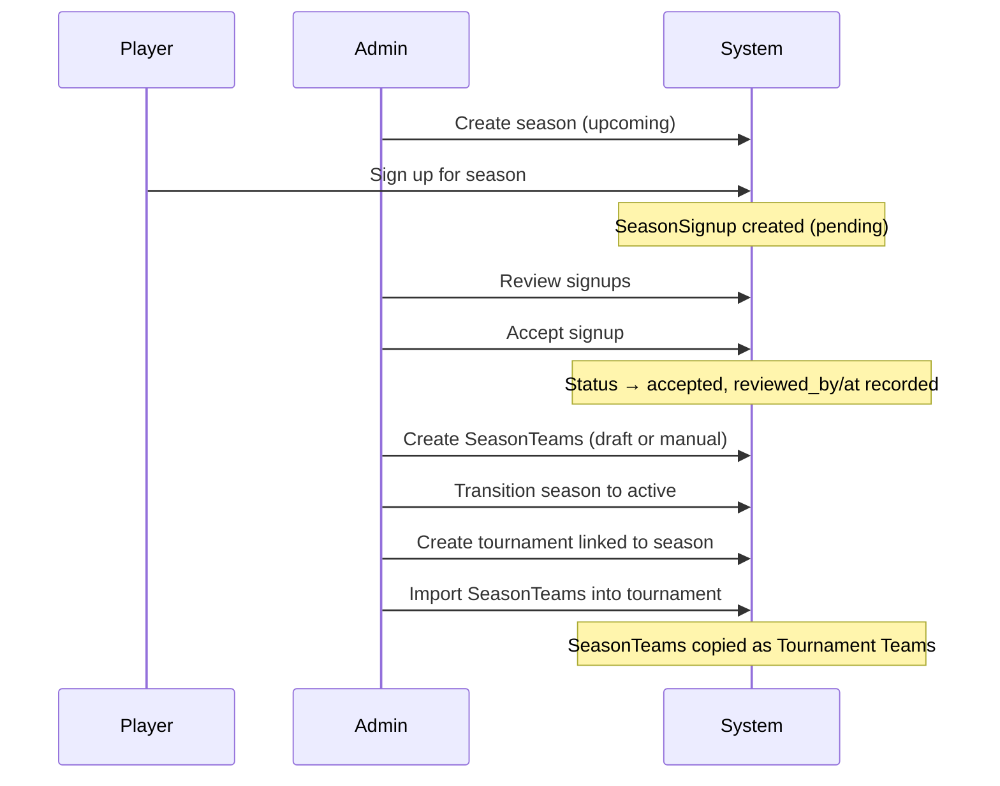

# Team Management & Seasons

Persistent team management within leagues, organized by seasons. Teams are formed per-season via draft or manual creation, then imported into tournaments.

## Overview

Currently, teams exist only within individual tournaments and are created during the draft process. This feature introduces **Seasons** as a container for teams within a league, allowing rosters to persist across multiple tournaments (group stages, playoffs, brackets) within a season.

---

## Core Concepts

### Hierarchy

### Season

A time-bounded chapter within a league. Contains a player pool (via signups) and teams.

| Field | Type | Description |
|-------|------|-------------|
| `league` | FK → League | Parent league |
| `name` | CharField | e.g., "Season 3" |
| `number` | IntegerField | Sequential (1, 2, 3...) |
| `status` | ChoiceField | `upcoming`, `active`, `completed` |
| `start_date` | DateTimeField | Season start |
| `end_date` | DateTimeField | Season end (nullable for open-ended) |
| `signup_deadline` | DateTimeField | When signups close (nullable) |
| `timezone` | CharField | Display timezone (consistent with League) |
| `created_at` | DateTimeField | Auto |
| `updated_at` | DateTimeField | Auto |

**Constraints:**

- `(league, number)` unique — no duplicate season numbers
- One `active` season per league at a time

**Status transitions:**

- `upcoming` → `active` → `completed`
- No backward transitions

### Season Signup

Players express interest in joining a season through their LeagueUser identity.

| Field | Type | Description |
|-------|------|-------------|
| `season` | FK → Season | Which season |
| `league_user` | FK → LeagueUser | Who signed up |
| `status` | ChoiceField | `pending`, `accepted`, `rejected` |
| `note` | TextField | Optional message from player |
| `signed_up_at` | DateTimeField | Auto |
| `reviewed_by` | FK → CustomUser | Admin who reviewed (nullable) |
| `reviewed_at` | DateTimeField | When reviewed (nullable) |

**Constraints:**

- `(season, league_user)` conditional unique for `pending`/`accepted` — prevents duplicate active signups while allowing re-signup after rejection

**Season members** are derived from accepted signups — no separate M2M. Query: `SeasonSignup.objects.filter(season=season, status='accepted')`.

### Season Team

Teams that belong to a season. Rosters persist across all tournaments within the season.

| Field | Type | Description |
|-------|------|-------------|
| `season` | FK → Season | Parent season |
| `name` | CharField | Team name |
| `captain` | FK → LeagueUser | Captain (nullable — can assign later) |
| `deputy_captain` | FK → LeagueUser | Deputy captain (nullable) |
| `members` | M2M → LeagueUser | Roster |
| `logo` | ImageField | Team logo (nullable) |
| `created_at` | DateTimeField | Auto |
| `updated_at` | DateTimeField | Auto |

**Constraints:**

- `(season, name)` unique
- A LeagueUser can only be on one SeasonTeam per season (enforced via validation)

### Tournament ↔ Season

The existing Tournament model gains:

| Field | Type | Description |
|-------|------|-------------|
| `season` | FK → Season | Optional season link (`on_delete=SET_NULL`, nullable) |

And the existing Team model gains:

| Field | Type | Description |
|-------|------|-------------|
| `season_team_source` | FK → SeasonTeam | Provenance tracking (`on_delete=SET_NULL`, nullable) |

Tournaments without a season work exactly as today. When linked to a season, an admin can **import SeasonTeams** as tournament teams. Import creates independent copies — changes to the SeasonTeam after import do not propagate.

---

## Signup Flow

---

## Team Formation

Seasons support two methods for forming teams:

### Draft-Based

Run a player draft at the season level. Captains are selected from the accepted signup pool, then draft from remaining members. Uses the existing draft system (snake, normal, shuffle).

### Manual Creation

Admins create SeasonTeams directly and assign members from the accepted signup pool. Useful for invite-only leagues or pre-formed teams.

---

## Tournament Import

When a tournament is linked to a season, the admin can import teams:

1. `POST /api/tournaments/{id}/import-season-teams/` copies SeasonTeams into Tournament Teams
2. Captain, deputy captain, members, name, and logo are copied
3. LeagueUser references are resolved to CustomUser for the Tournament Team model
4. After import, tournament teams are fully independent
5. Supports re-import if the tournament has not started (deletes and recreates)
6. Supports partial import (specific SeasonTeam IDs)

---

## Tournament Team Audit Log and Roster Service

Built in #544 (epic #490). Tournament teams (`tournament.Team`) get an audit table and one
service for roster changes. The staff API (#545) and the tournament team dialog (#546)
build on it.

### TeamLog

`tournament.TeamLog` records one row per team change. It is read-only in the Django admin, not
cached, and the app never deletes rows. A retention purge for it is a follow-up; #499's
nightly purge deletes sign-up ledger entries only.

| Field | Description |
|-------|-------------|
| `team` | FK → Team, `SET_NULL`: the row outlives the team |
| `event_team` | FK → EventTeam, `SET_NULL` (for event-team rows, #548) |
| `team_snapshot_id` | The team's id, kept after the team is deleted; history queries use it |
| `tournament_id`, `event_id`, `organization_id` | Snapshots, not FKs |
| `occasion_at` | Source event end, else its start, else the tournament date (for #499) |
| `team_name` | Name at write time |
| `actor` | Who made the change (null for system changes) |
| `via` | `web`, `discord`, `api` or `system` |
| `action` | See below |
| `target_user` | The player the change is about |
| `reason` | Staff reason; never written to logs |
| `override_rules` | Override codes the actor acknowledged, e.g. `["team_standin_cap"]` |
| `details` | `before` / `after` roster snapshots (name, captain, deputy, member, stand-in and dropout ids) plus action extras |
| `created_at` | Auto |

Actions: `set_captain`, `set_deputy`, `mark_dropout`, `restore_member`, `add_standin`,
`remove_standin`, `sub_in`, `rename`, `legacy_patch` (the old team PATCH),
`system_succession`, `empty_team_kept`, `team_deleted` and `materialize` (reserved for
#549).

### Roster service

`tournament/services/team_management.py` has `set_captain`, `set_deputy`, `mark_dropout`,
`restore_member`, `add_standin`, `remove_standin`, `sub_in(standin, replacing=None)` and
`rename`. Each takes `actor`, `via`, `reason` and `acknowledged_codes`, runs in one
transaction, writes exactly one TeamLog row, invalidates the team, tournament and player
caches after commit and sends `team_roster_changed` on commit. Refusals raise
`TeamManagementError(code, message)`; the message names the fix.

Rules:

- The captain and deputy must be members, and the deputy is not the captain. Making a
  stand-in captain moves them into the members first; the old captain stays a member.
  A captain who is not on the team (a ghost captain) can be re-seated.
- A change never adds a leadership problem, so a team with an existing problem can
  still be repaired one step at a time.
- A reason is required when the change affects a player other than the actor (except
  system changes). A rename affects no player, so the service needs no reason for it;
  the web API still requires a reason for every action, renames included. Reasons are at
  most 500 characters (`reason_too_long`). The API maps `reason_required` and the other
  refusal codes to 400 (#545).
- A dropout that would empty the team is refused; sub in a stand-in instead. Dropouts
  stay in the tournament. When the captain drops out, the deputy takes over, then the
  highest org MMR, then the lowest user id.
- A stand-in cannot be on another team in the same tournament.
- Stand-in limit: the source event's `team_max_standins`, else 2. Going over it
  (`team_standin_cap`, rule `override-warning`) or failing the source event's eligibility
  requirements (rule `staff-override`) needs a staff override: the actor acknowledges the
  codes and gives a reason, and the codes are stored in `override_rules`. The override
  check is the shared #585 contract (`events/overrides.py`); team codes are outside the
  org's warning codes, so the staff override policy does not change them.
- A captain change moves that captain's draft rounds in the tournament, picked and
  unpicked, to the new captain. Rounds find their team through the captain, so leaving
  picked rounds behind would point them at no team and break undo. When the old or new
  captain also captains another team in the tournament the rounds cannot be told
  apart, so none move (`draft_rounds_skipped_reason: old_captain_leads_other_team`).
  The change also adds the new captain to the tournament if needed, resets the team's
  draft presence, posts a `team_changed` event to a live team draft and refreshes a live
  hero draft.
- Subbing in a stand-in adds them to the tournament if needed (`added_to_tournament`,
  `org_user_created`, `league_user_created` in the row). A benched stand-in is not a
  tournament user.

### Changes to existing paths

- Removing the last member of a team used by bracket games or hero drafts keeps the team
  (`empty_team_kept` row) instead of deleting it and those games. An unused team is
  still deleted (`team_deleted` row). The kept team keeps its captain, which then shows
  as a leadership problem (#604).
- Captain succession after a member leaves writes a `system_succession` row. The
  `system_succession`, `empty_team_kept` and `team_deleted` rows invalidate caches and
  send `team_roster_changed` like service rows. Removing a regular member through the
  signal path, a draft reset clearing stand-ins and dropouts, and team creation write
  no row.
- The old team PATCH (`/api/teams/{id}/`) writes a `legacy_patch` row, adds members
  before removing them, refuses emptying a used team and returns 204 when it deletes an
  unused one. See [API endpoints](../../api/endpoints.md#updating-a-team).
- Current members, stand-ins and dropouts of the tournament's teams are left out of the
  draft pool.
- Undoing a pick refuses with 409 `pick_is_captain` when the picked player has since
  been made captain, and clears the player's dropout entry when they were marked as a
  dropout.
- `draft-rebuild` on a draft with rounds refuses with 409 `team_changes_logged` when any
  team in the tournament has a non-system audit row, since rebuilding from the picks
  would undo those changes. A rebuild skips picks who are now dropouts.

---

## Staff Team Management Dialog

!!! success "Implemented"
    This section describes a shipped feature, unlike the season plans above it on
    this page.

Built in #546 (epic #490) on the [team management API](../../api/endpoints.md#team-management). Staff
fix a tournament team's roster after the draft without leaving the tournament page.

### Who sees it

Open a team from the tournament's Teams tab (or anywhere that opens the team modal).
The team modal now lists the deputy, stand-ins and dropouts for everyone. Staff also
get a **Manage team** button. The button follows the server's `can_manage_team` flag,
so it shows for site staff, org staff, and league admins and staff of the tournament's
league, and never for players or signed-out visitors. The server still checks every
action.

### Roster tab

The Captain and Deputy selects sit above a roster table with one row per player:
members, then stand-ins, then dropouts. Each row shows the player, their role badges
(Captain, Deputy, Stand-in, Dropout) and MMR (stacked under the name on phones), and
an actions menu (⋮) with that player's actions. **Add stand-in** sits on the bar above
the table, next to the member, stand-in and dropout counts.

| Control | What it does |
|---------|--------------|
| Captain select | Makes another member captain. A captain who is not a member shows as "(not a member)". |
| Deputy select | Makes another member deputy, or "No deputy" clears it. |
| Make captain | In a member's actions menu; same as the captain select. |
| Make deputy / Clear deputy | In a member's actions menu; same as the deputy select. |
| Mark dropout | Moves a member to the dropouts. Disabled for the last member, with the reason shown in the menu: sub in a stand-in instead. When the captain drops out, the deputy takes over. |
| Restore | Moves a dropout back to the members. |
| Add stand-in | Searches users (at least 3 characters). Org staff see org and league members first, with anyone else under "Not in this organization". League staff who are not org staff search without membership labels. Players already on another team in the tournament are marked "On another team" and cannot be picked. |
| Sub in | Moves a stand-in into the members. Pick the player they replace, who becomes a dropout, or "No one". The captain is labelled "(captain)" in that list. |
| Remove stand-in | Removes a stand-in. |

Every action opens a confirm dialog that asks for a reason (3 to 500 characters). The
reason is saved in the team's history and never written to logs. A captain change, a
captain dropping out, or a stand-in replacing the captain warns that ready and connected state resets for any live hero
draft the team is in. While a change is being saved, every control is disabled.

When the server refuses a change it says why and how to fix it (for example, a stand-in
who is already on another team). A change that breaks a seating rule, such as going
over the stand-in limit, opens the shared override warning: it names the rule, and
staff confirm with a reason to go ahead. The acknowledged rules are stored with the
change. If the team was deleted meanwhile (for example by regenerating teams), the
dialogs close and a "This team no longer exists" message shows.

### Leadership problems

A team has a leadership problem when its captain or deputy is not a member (a "ghost"
captain or deputy), or the deputy is also the captain. These come from the same check
as `audit_team_leadership` (#604). Staff see them in three places:

- **Teams tab:** a "Teams with leadership problems (N)" card under the tournament
  errors, one row per affected team. **Review** opens that team.
- **Team cards:** a "Leadership issue" badge next to the team name; its tooltip names
  the player and the problem.
- **Team modal and dialog:** badges beside the captain or deputy, and a banner at the
  top of the Roster tab with a fix for each problem.

| Problem | Fixes offered |
|---------|---------------|
| Captain is not a member | **Reseat** them as a member and keep them captain (a dropout or stand-in of this team is restored or moved), or **Choose another captain** |
| Deputy is not a member | **Clear deputy**, or **Choose another deputy** |
| Deputy is also the captain | **Clear deputy**, or **Choose another deputy** |

Players and other viewers do not see the flags.

### History tab

The History tab lists the team's audit rows, 25 per page, newest first: when, who
(or "System"), where from (web, Discord, API or system), the action, the player, the
reason, any acknowledged override rules, and what changed (for example
"captain: A -> B" or "members: 5 -> 4"). A player who can no longer be looked up shows
as its id, for example "Player #12".

---

## Data Location

New models live in the `league` app (alongside `LeagueUser`), not in the already-large `app/models.py`:

- `league/models.py` — Season, SeasonSignup, SeasonTeam
- `tournament/models/tournament.py` and `tournament/models/team.py` — Tournament gains `season` FK, Team gains `season_team_source` FK

---

## Edge Cases

| Scenario | Behavior |
|----------|----------|
| Member removed from season while on a SeasonTeam | Remove from SeasonTeam members. Block removal if they are captain (must reassign first). |
| SeasonTeam modified after tournament import | No effect — tournament teams are independent copies. |
| Season deleted | Tournament.season set to NULL (SET_NULL). Tournament continues working. |
| LeagueUser leaves league | SeasonSignup cascade-deleted. SeasonTeam.captain set to NULL. M2M membership auto-removed. |
| Two active seasons in same league | Prevented by database constraint. |
| Signup after deadline | Rejected at API level if `signup_deadline` has passed. |

---

## Design Decisions

| Decision | Rationale |
|----------|-----------|
| SeasonTeam separate from Team | SeasonTeams are roster templates; Tournament Teams have tournament-specific fields (placement, points, draft_order, drop-ins). |
| Copy semantics on import | Competitive integrity — mid-tournament roster changes should not propagate from season. |
| Members derived from accepted signups | Single source of truth, no M2M sync issues. |
| LeagueUser as participation identity | Keeps MMR context, enforces league membership, consistent with existing `Team.league_users`. |
| ImageField for logo | Future-proofs for file uploads; existing URLField on Organization will migrate to ImageField. |
| Models in league app | Keeps app/models.py manageable; follows existing OrgUser/LeagueUser pattern. |

---

## Problems and Solutions

| Problem | Solution |
|---------|----------|
| Teams disappear between tournaments | Seasons persist teams across tournaments |
| No signup workflow for seasons | SeasonSignup with pending/accepted/rejected flow |
| Roster changes mid-tournament | Import creates independent copies |
| No team branding | ImageField logo on SeasonTeam |
| Duplicate signups | Conditional unique constraint |
| Stale season status | One-active-per-league constraint + enforced transitions |

**Status:** :material-pencil: Design Complete
